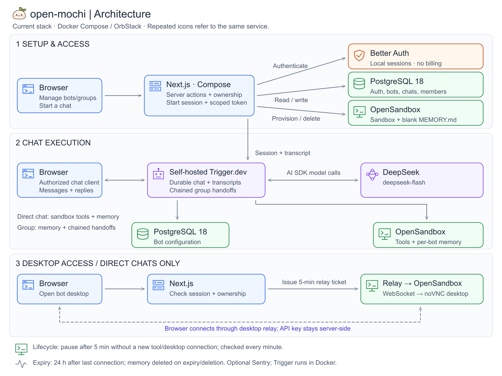

# open-mochi

A self-hosted AI workspace for individual and group chats, with persistent bot
memory, sandbox tools, and browser-accessible Linux desktops. Based on
[Mochi](https://github.com/taufiq0205/mochi).

Runs locally with Docker Compose: Next.js, Better Auth, PostgreSQL, self-hosted
Trigger.dev, and OpenSandbox. Chat uses the DeepSeek API; Sentry is optional.
There are no subscriptions or usage allowances in the application. You pay any
external provider costs directly.

## Before you start

- Docker Engine with Compose; on macOS, use OrbStack. Allow at least **7 CPUs and
  14 GB RAM for Trigger and its workers**, plus room for the app and bot sandboxes.
- Node.js **24** and npm for the one-time worker deployment.
- A DeepSeek API key with available credits, and internet access for image,
  package, and build-time font downloads. No GPU is required.

The steps below target a local OrbStack installation. Linux and remote-host
networking require the adjustments in [Trigger setup](docs/trigger.md) and
[sandbox setup](docs/sandboxes.md).

## First-time setup

### 1. Configure the application

```sh
git clone https://github.com/taufiq0205/open-mochi.git
cd open-mochi
cp .env.example .env
chmod 600 .env
```

Edit `.env`:

| Setting | Value |
| --- | --- |
| `POSTGRES_PASSWORD` | Generate with `openssl rand -hex 32` |
| `BETTER_AUTH_SECRET` | Generate another independent value |
| `OPEN_SANDBOX_API_KEY` | Generate another independent value |
| `DEEPSEEK_API_KEY` | Your DeepSeek API key |

Keep the default localhost URLs for local use. Leave Sentry settings blank to
skip monitoring. Keep these secrets stable across restarts.

### 2. Set up Trigger and initialize the database

Follow [Trigger first setup](docs/trigger.md#first-setup) to create the platform
environment file, registry credentials, and Docker HTTP registry configuration.
These are required before Compose can start.

Initialize the application database, then start the services:

```sh
docker compose up -d --wait postgres
docker compose run --rm db-tools
docker compose up -d --build --wait
```

For an existing database, back up first and review any proposed schema deletion.
Schema changes are never applied automatically at app startup.

### 3. Connect and deploy the chat worker

Open **http://localhost:8030**. Sign in using your allowed operator email; the
local sign-in link appears in the `trigger-webapp` logs. Create an organization
and project, then copy its project ref and **Production** environment key into
root `.env` as `TRIGGER_PROJECT_REF` and `TRIGGER_SECRET_KEY`.

Follow [Deploy the worker](docs/trigger.md#deploy-the-worker) to install the local
CLI profile, configure the project's Production variables, and deploy the tasks.
The worker needs the application database credentials, DeepSeek key, and
OpenSandbox settings too; root `.env` is not automatically copied to it.

After deploying, rebuild the web service and confirm the
`pause-idle-opensandboxes` schedule is active in Trigger:

```sh
docker compose up -d --build --wait web
```

Open **http://localhost:3000**, create an account, create a bot, and start a chat.
Test a sandbox tool and open the bot desktop to verify the full setup.

## Everyday use

Once configuration, database initialization, and worker deployment are complete:

```sh
docker compose up -d --build  # Start or rebuild the stack
docker compose ps           # Check service health
docker compose stop         # Stop without removing data
```

Application code changes that affect tasks also require a separate worker
redeployment. Rebuilding the web image does not deploy workers.

If chat stalls, check the deployed worker and its Production variables first:

```sh
docker compose logs --tail=100 web trigger-webapp
curl --fail http://localhost:3000/healthz
```

`/healthz` checks only the web process. It does not verify login, inference,
worker execution, desktop access, or telemetry.

## Architecture



[Open SVG](docs/project-architecture.svg) ·
[Edit in Excalidraw](docs/project-architecture.excalidraw)

- Direct chats have sandbox tools and memory; groups use memory and handoffs,
  consulting each member at most once per turn.
- Desktop access checks ownership and uses a five-minute relay ticket. The
  OpenSandbox API key stays server-side.
- A scheduled check runs every minute and pauses sandboxes five minutes after
  their last tool/desktop connection. Activity inside an already-open desktop
  does not refresh that deadline; reconnect as needed.
- Native sandbox expiry is 24 hours after the last tool/desktop connection.
  Memory survives pause/resume but is deleted with its sandbox on expiry/deletion.

## Data and remote access

Compose keeps service data in named volumes. Bot files and `MEMORY.md` live in
OpenSandbox-managed containers; a PostgreSQL backup alone does not include them.
Do not run `docker compose down -v` unless you intend to delete service data.
See [sandbox storage](docs/sandboxes.md#isolation-and-storage) for bot data details.

Ports bind to localhost. Before remote use, configure a TLS reverse proxy,
browser-reachable application/Trigger/desktop URLs, and WebSocket support.
Rebuild the web image after changing its public Trigger or Sentry configuration.
Keep Docker control endpoints, databases, and server secrets private.

## Further reading

- [Trigger platform, registry, worker deployment, and networking](docs/trigger.md)
- [Sandbox configuration, isolation, lifecycle, and checks](docs/sandboxes.md)
- [Authentication setup](docs/auth.md)
- [Migration status and verification limits](docs/plan.md)

Future work: evaluate assistant-ui for richer chat interactions while retaining
AI SDK and compatibility with the self-hosted Trigger transport.
